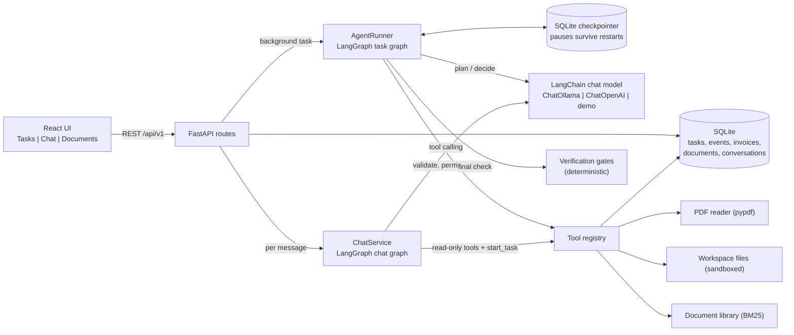
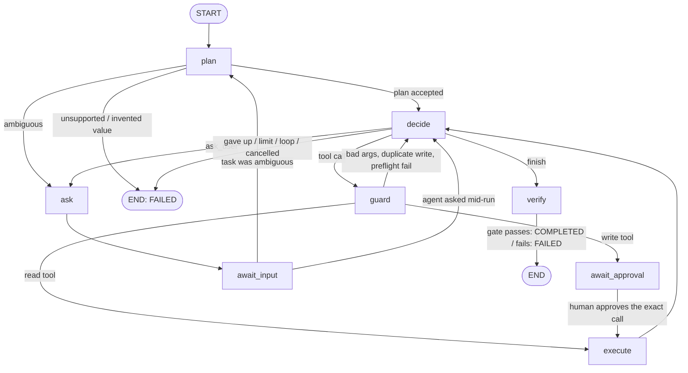

# TaskPilot v2: an AI task worker you can talk to (LangChain + LangGraph)

An internship prototype. You give it a task in plain English; the worker **plans**, picks from a small set of **registered tools**, **observes** real results, **recovers** from errors, asks for **human approval** before writing, and only reports success after an **independent verification** against the source of truth. In v2 the agent runs on **LangGraph**, the model is reached through **LangChain**, and you can **chat** with it and give it your own **documents**.

What changed from v1 (the hand-written loop):

| | v1 | v2 |
|---|---|---|
| Agent loop | hand-written `while` loop and state machine | **LangGraph `StateGraph`** with nodes `plan, decide, guard, await_approval, execute, verify, ask, await_input` |
| Human approval / questions | status flags polled by a loop | **LangGraph `interrupt()`** + SQLite **checkpointer**: a pause survives a server restart |
| LLM access | hand-written `httpx` calls | **LangChain** chat models (`ChatOllama`, `ChatOpenAI`), prompt templates, output parsers |
| Talking to it | none | **Chat tab**: a second LangGraph agent with LangChain tools (search/read your documents, look up invoices, start and check tasks) |
| Inputs | invoice PDFs only | **Documents tab**: upload PDF, DOCX, TXT, MD, CSV; keyword search (BM25) |
| Task types | invoice ingest, file search | + **document Q&A with verified citations** |

Everything that made v1 trustworthy is kept: tool sandbox, approval bound to the exact call, duplicate prevention, deterministic verification gate.

> Prototype, not production. See [Known limitations](#12-known-limitations) for exactly what it does not do.

---

## 1. What is implemented

| Area | What exists |
|---|---|
| Task agent | LangGraph state machine (below). Statuses: `PENDING, PLANNING, RUNNING, AWAITING_APPROVAL, VERIFYING, COMPLETED, FAILED, NEEDS_INPUT, CANCELLED`. |
| Chat agent | Conversations stored in SQLite. Per message, a LangGraph `agent <-> tools` loop with 11 tools. The assistant can read and report, and can **start** a task, but it can never save, approve or delete anything itself. |
| Tools | 14 registered tools, each with a Pydantic input model and a `read`/`write` permission. Only one is a write tool (`create_invoice_record`). No shell, no arbitrary code. |
| Documents | Upload `.pdf .docx .txt .md .csv` (5 MB each). Text extraction, chunking, BM25 ranking with light stemming. Duplicate and fake-file rejection. |
| Document Q&A | A task type. The answer completes only if every citation is a **verbatim quote** from a document the agent actually read in that task. |
| Invoices | 6 sample PDFs, strict field validation, latest invoice chosen by date, saved via SQLAlchemy, unique constraint on `(company, invoice_number)`. |
| Safety | Workspace sandbox, argument validation, approval before writes, bounded retries, step/time limits, duplicate prevention, prompt-injection handling, safe cancellation. |
| API | FastAPI, 24 endpoints under `/api/v1` (tasks, invoices, documents, conversations, graph, health). |
| UI | React + Vite + TypeScript + Tailwind with three tabs: **Tasks**, **Chat**, **Documents**. |
| Tests | 107 backend (pytest) + 15 frontend (vitest). Results in [`docs/TEST_RESULTS.txt`](docs/TEST_RESULTS.txt). |

## 2. Architecture



### Who decides what

| Decided by the LLM | Enforced by deterministic code |
|---|---|
| What the task means (task type, company / keyword / question) | Is the tool registered? Are the arguments valid? |
| Which tool to call next, given the observations | Is the path inside the workspace? Is a write approved? |
| When to give up, ask the user, or claim "finished" | Retries, step and time limits, duplicate prevention |
| The wording of the answer | Whether the outcome is actually true (verification gate) |

## 3. The task graph (LangGraph)



`await_approval` and `await_input` call LangGraph's `interrupt()`. The graph state is saved by a SQLite checkpointer (`backend/data/taskpilot.checkpoints.db`), so a task waiting for you stays waiting across restarts, and `POST /tasks/{id}/approve` resumes it with `Command(resume=...)`. The resume value carries the hash of the exact call that was approved; any mismatch fails the task instead of writing. `GET /agent/graph` returns the live Mermaid source; `GET /tasks/{id}/graph` also says which node a task is waiting at.

One iteration of the tool loop (`backend/app/agent/runner.py`):

1. `decide`: ask the LLM for a structured `Decision` (`tool | finish | ask_user | fail`), validated with Pydantic.
2. `guard`: resolve the tool and validate its arguments; reject unknown tools, bad arguments, repeated writes and writes whose values differ from the source PDF (as an error *observation*, the loop continues). A write tool pauses at `await_approval`.
3. `execute`: run the tool. Transient errors are retried with backoff. A write that times out first checks the database and never inserts twice.
4. Record the real result as an event and an observation; merge facts into memory; flag instruction-like document text.
5. Repeat, or go to `verify` when the LLM says `finish`.

### Planning, memory, recovery, verification

- **Planning.** The LLM returns a `Plan` (task type, parameters, steps, expected outcome, whether a write is needed). Code rejects plans whose company/keyword does not appear in the user's text.
- **Memory.** `facts` and the observation `history` live in the graph state and are mirrored to SQLite after every step for the UI. The LLM sees the facts and the last 6 observations.
- **Verification gates** (`backend/app/agent/gates.py`):
  - *Invoice:* re-reads the PDFs and database, compares every field, checks exactly one record and no stray writes.
  - *File search:* re-scans the workspace with a different matching method and compares filename lists.
  - *Document Q&A:* every citation's `document_id` must exist, the agent must have read or searched that document in this task, and the quote must occur verbatim (whitespace/case-insensitive) in the stored text. No citations, no pass.

## 4. Chat

The Chat tab talks to `POST /conversations/{id}/messages`. Per message, `ChatService` builds a small LangGraph graph (`agent -> tools -> agent -> ... -> END`).

| Chat tool | Kind |
|---|---|
| `list_documents`, `search_documents`, `read_document` | read |
| `list_invoice_records`, `search_internal_invoices` | read |
| `list_workspace_files`, `search_file_contents`, `read_text_file` | read |
| `list_tasks`, `get_task_status` | read |
| `start_task` | hands work to the task worker (max 2 per message) |

- The assistant **cannot approve its own writes**. If you ask it to save an invoice it starts a task; the task stops at `AWAITING_APPROVAL` and waits for you in the Tasks tab. Tests assert that no write tool is exposed to chat.
- Tool results and document text are marked untrusted in the system prompt and flagged when they contain instruction-like text.
- Tool-call loops are capped (`CHAT_MAX_TOOL_ROUNDS`, default 6); after that the model must answer without tools.
- `TOOL_CALLING=native` (default) uses the model's own tool calling through LangChain `bind_tools`. `TOOL_CALLING=json` asks for one JSON action per turn instead, for models without tool support. Both go through the same graph.
- Nothing is saved for a turn whose model call fails, so you can retry; the UI keeps your text in the box.
- Chat history sent to the model is the last `CHAT_HISTORY_MESSAGES` (default 20) messages. Past tool results are not replayed, only the visible conversation.

## 5. Documents

Upload on the **Documents** tab (or `POST /api/v1/documents`). Text is extracted (`pypdf` for PDF; DOCX read from its XML; plain decode for TXT/MD/CSV), cleaned, split into overlapping passages, and stored in SQLite. Search is BM25 over passages with light stemming (`refunds`, `refunded` and `refund` match), implemented in `backend/app/documents/search.py` with no extra service. Rejected with a clear message: unsupported types, empty or binary files, fake PDFs/DOCX, scanned PDFs with no text (no OCR), files over 5 MB, exact duplicates. Stored file names never use the client's path.

Sample files to try are in `sample_data/documents/`.

Use them three ways: ask in **Chat**; run a **document Q&A task** (verified citations); or **Search** on the Documents tab.

## 6. Technology and model actually used

| Layer | Choice |
|---|---|
| Backend | Python 3.12, FastAPI, Pydantic v2, SQLAlchemy 2, SQLite (WAL), pypdf, httpx |
| Agent | **LangGraph 1.2** (`StateGraph`, `interrupt`, `SqliteSaver`), **LangChain** (`langchain-core`, `langchain-ollama`, `langchain-openai`) |
| Frontend | React 18, Vite 5, TypeScript, Tailwind CSS 3, Lucide React, Axios |
| LLM | `LLM_PROVIDER=ollama` (default; Ollama Cloud or local), `openai` (any OpenAI-compatible endpoint), or `demo` |

**What I actually ran:** the automated tests and a live uvicorn run used `demo` mode, scripted fake models, and **fake HTTP servers standing in for Ollama and the OpenAI API** (so the real `ChatOllama`/`ChatOpenAI` code, request bodies, auth headers, JSON mode, tool-call parsing and error mapping were exercised). **No real LLM (not gemma4, not Mistral, not a hosted model) was reachable in the build environment, so I have not tested real model output quality.** In particular I could not confirm that `gemma4:31b` supports tool calling on Ollama Cloud: if chat reports that, set `TOOL_CALLING=json`.

**Demo mode is not an LLM.** `DemoClient` (task rules) and `DemoChatModel` (chat) are small rule sets so the app can be demonstrated without a model. The UI shows a banner. The app never switches to demo on its own.

## 7. Design decisions and trade-offs

- **LangGraph for control flow, not for trust.** The graph gives explicit nodes, durable pauses and resumable runs. The safety rules still live in plain code inside the nodes, and are covered by tests that I broke on purpose (mutation checks) to confirm they fail when the rule is removed.
- **JSON decisions for the worker, native tool calling for chat.** The worker needs `finish / ask_user / fail` plus a verification contract and works with weak local models via JSON mode. Chat is open-ended, so it uses the model's tool calling (with a JSON fallback).
- **Verify with code, not with the LLM.** An LLM saying "done" is a claim; the gate re-derives the truth.
- **Approval bound to the exact call.** The approval stores a hash of tool + arguments; the resume must present it. Money is integer cents; amounts are normalised (`4275` and `4275.00` are the same call).
- **Injected text is data.** Tools return parsed fields or flagged snippets; instruction-like text raises a `security` event; and even a fully fooled model has no delete tool and cannot skip approval.
- **Restart behaviour.** Runs that were *executing* when the server died are marked `FAILED` (resuming mid-write is not safe). Runs *paused* for approval or input survive and resume.
- **Polling, not SSE;** `BackgroundTasks` instead of a job queue; chat replies are not streamed.

## 8. Windows setup (PowerShell)

Prerequisites: Python 3.12, Node.js 20+ (22 tested), Git. Optional: [Ollama](https://ollama.com).

> Developed and tested on Linux. The code uses `pathlib` throughout and the instructions below use standard PowerShell equivalents, but I have not run it on Windows.

### Backend

```powershell
cd taskpilot\backend
py -3.12 -m venv .venv
.\.venv\Scripts\Activate.ps1          # if blocked: Set-ExecutionPolicy -Scope CurrentUser RemoteSigned
pip install -r requirements-dev.txt   # use requirements.txt if you only want to run, not test (installs LangChain + LangGraph)
Copy-Item .env.example .env
python -m app.init_db                 # creates backend\data\taskpilot.db (also happens automatically on startup)
uvicorn app.main:app --reload --port 8000
```

Open http://127.0.0.1:8000/docs for the interactive API docs.

### Frontend (second terminal)

```powershell
cd taskpilot\frontend
npm install
Copy-Item .env.example .env           # optional; the dev server proxies /api to port 8000
npm run dev
```

Open http://localhost:5173.

### Choose the reasoning engine (`backend\.env`)

**Option A0: Ollama Cloud with Gemma 4 (fastest to set up, no local GPU)**

1. Create an API key at https://ollama.com/settings/keys.
2. In `backend\.env`:

```
LLM_PROVIDER=ollama
OLLAMA_BASE_URL=https://ollama.com
OLLAMA_API_KEY=your_key_here      # keep out of git; .env is ignored
OLLAMA_MODEL=gemma4:31b           # API name. 'gemma4:cloud' is the CLI name and will 404 here
```

3. Restart uvicorn and check `GET /api/v1/health`: `llm_ok` must be `true` and the UI header shows `ollama-cloud / gemma4:31b`. Cloud usage is subject to your Ollama plan's limits (HTTP 429 is reported as `llm_unavailable`).

**Option A: local Mistral through Ollama**

```powershell
ollama pull mistral
ollama list                                            # 'mistral' must appear
Invoke-RestMethod http://127.0.0.1:11434/api/tags      # Ollama is reachable
```

`.env`: `LLM_PROVIDER=ollama`, `OLLAMA_MODEL=mistral`. The UI header turns red if Ollama or the model is missing; `GET /api/v1/health` reports the same.

**Option B: hosted OpenAI-compatible API**

```
LLM_PROVIDER=openai
OPENAI_API_KEY=sk-...        # keep out of git; .env is ignored
OPENAI_MODEL=gpt-4o-mini
OPENAI_BASE_URL=https://api.openai.com/v1   # or Groq/OpenRouter/etc.
```

**Option C: demo mode (no model)**: `LLM_PROVIDER=demo`. Clearly labelled; not an LLM.

After editing `.env`, restart uvicorn.

### Regenerate sample data (optional)

The PDFs and text files are committed. To recreate them: `cd backend; python -m scripts.generate_sample_data`.

## 9. API

Base path `/api/v1`. Interactive docs at `/docs`.

| Method | Path | Purpose |
|---|---|---|
| GET | `/health` | Service + LLM provider status, chat availability |
| GET | `/agent/graph` | The task graph as Mermaid text |
| POST / GET | `/tasks`, `/tasks/{id}` | Create a task `{ "text": "..." }`; read a task |
| POST | `/tasks/{id}/start` | Run the agent in the background (409 unless PENDING) |
| POST | `/tasks/{id}/approve` | `{ "approved": true/false }` resumes or cancels the paused write |
| POST | `/tasks/{id}/input` | Answer a question (`NEEDS_INPUT`); resumes the graph |
| POST | `/tasks/{id}/cancel` | Cancel (immediately, or at the next safe point; second click forces) |
| GET | `/tasks/{id}/events?after=N` | Execution events with `seq > N` |
| GET | `/tasks/{id}/graph` | The graph plus the node the task is waiting at |
| GET | `/invoices`, `/invoices/{id}` | Records in the internal invoice system |
| POST | `/invoices/upload` | Add an invoice PDF to the workspace |
| POST / GET | `/documents`, `/documents/{id}` | Upload (multipart) / read a library document |
| GET | `/documents`, `/documents/search?q=` | List / BM25 search |
| DELETE | `/documents/{id}` | Remove a document |
| POST / GET | `/conversations`, `/conversations/{id}` | Create / read a conversation with messages |
| DELETE | `/conversations/{id}` | Delete a conversation |
| POST | `/conversations/{id}/messages` | `{ "text": "..." }`: one chat turn; returns both messages, the tool trace and any started task ids. 503 with a clear reason if the model is unavailable |

## 10. Tests

```powershell
cd backend;  pytest                       # 107 tests
cd frontend; npm test                     # 15 tests
cd frontend; npm run build                # type-check + production build
```

Results from the build environment are in [`docs/TEST_RESULTS.txt`](docs/TEST_RESULTS.txt). Highlights:

- **Original ten behaviours** (latest invoice, real PDF extraction, SQLite save, independent verification, no duplicates, missing invoice, wrong amount fails, tool failure handling, approval enforced, LLM failure is not success) all still pass on LangGraph.
- **LangGraph:** approval is a real interrupt; a pending approval survives constructing a brand-new app (a restart); a forged approval key writes nothing; ambiguous tasks ask, then re-plan; mid-run questions resume the same run; long runs do not hit LangGraph's default recursion limit.
- **LangChain path:** `ChatOllama`/`ChatOpenAI` against fake HTTP servers: bearer key, JSON mode, `num_ctx` only for local, error classification, JSON repair, and whole tasks through prompt -> model -> parser -> graph.
- **Documents and Q&A:** every file type, rejections, duplicates, search, stemming, fabricated or unread citations fail verification.
- **Chat:** answers from documents, starts a task but cannot approve it, no write tool exposed, native and JSON tool calling, unknown tool/bad arguments, loop cap, provider failure = 503 and nothing saved.
- Safety rules were **mutation-checked**: removing the quote check, approval-key check, write approval, "document was read" check, or exposing a write tool to chat each made a test fail.

A bug in v1 was found and fixed while porting: a repeated write typed as `4275` instead of `4275.00` slipped past the duplicate-write check and asked for approval twice (its regression test was failing in the v1 zip).

## 11. Demo walkthrough

See [`docs/DEMO_SCRIPT.md`](docs/DEMO_SCRIPT.md) (about 8 minutes), including chat, documents, and the restart-survives-approval scenario.

## 12. Known limitations

- **Real-model behaviour is untested by me** (see section 6): output quality of Mistral/gemma4/hosted models, and whether your model supports tool calling. Weak models may need `LLM_MAX_REPAIRS` raised, a bigger model, or `TOOL_CALLING=json`.
- Demo mode only understands a few phrasings.
- Task types: invoice ingest, workspace file search, document Q&A. Anything else fails with `unsupported_task`. Chat is more flexible but read-only.
- Document search is keyword-based (BM25 + light stemming), not semantic: a question that shares no words with the text will miss. No OCR; no tables-aware PDF parsing; PDFs are read up to 200 pages.
- A citation check proves the quote exists in the document; it cannot prove the *answer* is a correct reading of the quote.
- A server restart during *execution* fails that task; there is no automatic retry. Paused tasks do resume.
- Checkpoint files grow with every step; there is no cleanup job.
- No auth, rate limiting, or multi-tenant isolation. The document library and chats are shared by everyone who can reach the API. Not for production or untrusted networks.
- Prompt-injection detection is a regex heuristic (a signal for the UI). The real protections are structural: limited tools, approval, and the verification gate. A model reading a hostile document can still be *misled* in chat; it cannot write anything.
- Chat replies are not streamed; polling UI for tasks.
- Not tested on Windows or macOS by me (developed and tested on Linux).

## 13. Future improvements

- Stream chat tokens and task events (SSE).
- Embedding-based retrieval alongside BM25; OCR for scanned files.
- Resume interrupted executions where safe; checkpoint cleanup.
- Per-task provider selection in the UI; evaluation harness against real models.
- Authentication, per-user libraries and approvals.

## 14. Publishing to GitHub

```powershell
cd taskpilot
git init
git add .
git status                      # confirm no .env, .venv, node_modules or .db files are listed
git commit -m "TaskPilot: autonomous AI task worker prototype"
git branch -M main
git remote add origin https://github.com/<your-username>/taskpilot.git
git push -u origin main
```

Create the empty `taskpilot` repository on github.com first (no README/license so the push is clean). Never commit `.env`; only `.env.example` is tracked.

## Troubleshooting

| Symptom | Fix |
|---|---|
| UI banner "Cannot reach the backend" | Start uvicorn on port 8000; check `http://127.0.0.1:8000/api/v1/health` |
| Task fails with `llm_unavailable: Cannot reach Ollama` | Start Ollama (`ollama serve`) or set another provider |
| `model 'mistral' not found` | `ollama pull mistral` |
| Task fails with `llm_invalid_output` | The model did not return valid JSON after repairs. Try a larger model or raise `LLM_MAX_REPAIRS` |
| `plan_invalid` | The model used a company/keyword that is not in your task text. Rephrase or retry |
| `Activate.ps1 cannot be loaded` | `Set-ExecutionPolicy -Scope CurrentUser RemoteSigned` |
| Port 8000 or 5173 in use | Pick another port; for the frontend change `server.port` and the proxy target in `vite.config.ts` |
| Want a clean database | Stop the backend and delete `backend\data\taskpilot.db*` |
| Demo the write-timeout recovery | Set `FAULT_INJECTION=write_timeout_once` in `.env`, restart, run the invoice task |
| `pip install` fails building a package | Make sure you are on Python 3.12 (`python --version`) |

---

## Uploading your own invoice PDFs

In the UI, use **Upload an invoice PDF** (right column), pick a PDF, then click **Use in a task** and **Run task**.

- The PDF is copied into `sample_data/invoices/` as `upload_<time>_<name>.pdf`, so the worker finds it like any other invoice.
- It must contain real text (not a scan/photo) with lines like `Vendor:` (or `Supplier:` / `From:`), `Invoice Number:` (or `Invoice No:` / `Invoice #:`), `Invoice Date:`, `Due Date:` (or `Payment Due:`), `Total Due:` (or `Amount Due:` / `Total:`) and `Currency:` (a `$`, `€`, `£`, `₹` or a 3-letter code next to the total also works).
- Rejected with a clear message: non-PDF files, fake PDFs, files over 2 MB (`MAX_FILE_BYTES`), duplicates of an existing file, and PDFs whose fields cannot be read. Nothing is saved in those cases.
- Uploading needs one extra package: re-run `pip install -r requirements.txt` (adds `python-multipart`).

